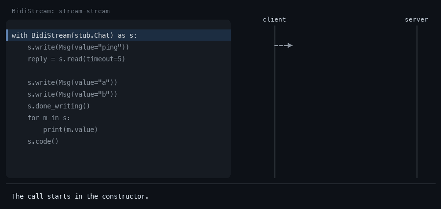
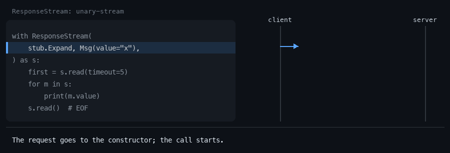
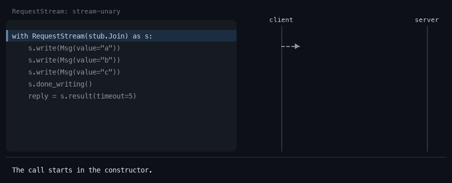

# grpc-sync-stream

`write()`, `read()`, `done_writing()`, `EOF` and the call status for streaming
calls of **synchronous** `grpcio` — the interface `grpc.aio` has, without asyncio.

```python
with BidiStream(stub.Chat, metadata=(("x-user", "a"),), timeout=30) as s:
    s.write(Msg(value="hi"))
    assert s.read(timeout=5).value == "HI"
    s.done_writing()
    assert s.read() is EOF
    assert s.code() == grpc.StatusCode.OK
```

## Why

Sync `grpcio` exposes a streaming call as an iterator in each direction: you
hand it a request iterator up front, and you get a response iterator back.
That fits "send everything, then read everything", but not a conversation:
send a message, wait for the reply with a timeout, decide what to send next.
Doing that by hand means a request generator over a queue, a reader thread,
sentinels so neither side hangs, and care to keep the real status code.

`grpc.aio` already has `write()` / `read()` / `done_writing()`, but it needs an
event loop. This package gives the same shape to sync code: tests, scripts and
CLIs, sync applications with a handful of streams.

## Install

```
pip install grpc-sync-stream
```

The only dependency is `grpcio` (>= 1.49.1). Python 3.10+.

## Quickstart

In the snippets, `stub` is your generated stub and `Msg` your message type.

### Bidirectional stream: `BidiStream`



```python
from grpc_sync_stream import EOF, BidiStream

with BidiStream(stub.Chat, timeout=30) as s:
    s.write(Msg(value="ping"))
    reply = s.read(timeout=5)  # the next message, or EOF
    assert reply is not EOF and reply.value == "PING"

    s.write(Msg(value="a"))
    s.write(Msg(value="b"))  # write() never blocks
    s.done_writing()  # half-close: no more requests
    assert [m.value for m in s] == ["A", "B"]  # iterate until EOF
    assert s.code() == grpc.StatusCode.OK
```

### Server stream: `ResponseStream`



The request goes to the constructor.

```python
from grpc_sync_stream import EOF, ResponseStream

with ResponseStream(stub.Expand, Msg(value="x"), read_timeout=5) as s:
    first = s.read()
    assert first is not EOF and first.value == "x-0"
    assert [m.value for m in s] == ["x-1", "x-2"]
    assert s.read() is EOF
```

### Client stream: `RequestStream`



```python
from grpc_sync_stream import RequestStream

with RequestStream(stub.Join) as s:
    for word in ("a", "b", "c"):
        s.write(Msg(value=word))
    s.done_writing()
    assert s.result(timeout=5).value == "A,B,C"
```

### Errors keep their real status

```python
from grpc_sync_stream import BidiStream

with BidiStream(stub.Chat) as s:
    s.write(Msg(value="fail"))
    try:
        s.read(timeout=5)
    except grpc.RpcError as err:
        assert err.code() == grpc.StatusCode.INVALID_ARGUMENT
    assert s.code() == grpc.StatusCode.INVALID_ARGUMENT
    assert s.details() == "boom"
```

Runnable versions with a local echo server are in [`examples/`](examples).

## API

| Class | Call type | Methods |
|---|---|---|
| `BidiStream[Req, Resp]` | stream-stream | `write`, `done_writing`, `read`, iteration |
| `ResponseStream[Resp]` | unary-stream | request in the constructor; `read`, iteration |
| `RequestStream[Req, Resp]` | stream-unary | `write`, `done_writing`, `result(timeout)` |

The first argument is the multicallable from the stub. `metadata`, `timeout`,
`credentials`, `wait_for_ready` and `compression` are passed through to grpc.
The call starts in the constructor.

All three also have:

- `code()`, `details()`, `trailing_metadata()` — wait for the call to end, as in sync grpc;
- `initial_metadata()` — waits for the server's initial metadata, as in sync grpc;
- `cancel()`, `done()` — once `read()` / `result()` has reported the end,
  `done()` is `True` and `write()` fails;
- `with` support.

Extra constructor options: `read_timeout` (`BidiStream`, `ResponseStream`) is the
default timeout for `read()`; `max_pending_writes` (`BidiStream`, `RequestStream`)
bounds the request queue.

### `read(timeout=None)`

| Situation | `read()` |
|---|---|
| a message arrived | returns it |
| the stream ended with OK | returns `EOF` at once, and again on every later call |
| the stream ended with an error | raises that `grpc.RpcError` (with the real status) at once, and the same error on every later call |
| nothing arrived within `timeout` | raises the built-in `TimeoutError`; the stream stays usable, `read()` can be called again |
| after `cancel()` | raises `grpc.RpcError` with `CANCELLED`, like sync grpc |
| no `timeout` passed | uses `read_timeout` from the constructor; by default (`None`) waits without limit |
| negative `timeout` | raises `ValueError` |

`for msg in stream` reads until `EOF` and raises the call's error.
`EOF` is a module-level singleton: compare with `is`. Its type, `EOFType`, is exported
for annotations, and `msg is not EOF` narrows `Resp | EOFType` to `Resp` for type checkers.

### `write()`, `done_writing()`, `cancel()`, `with`

- `write(msg)` does not block: the request queue is unbounded. With
  `max_pending_writes=N` it blocks while `N` messages are waiting to be sent.
- `write()` after `done_writing()` raises `RuntimeError`. If the call has already
  failed, `write()` raises its `grpc.RpcError`; if it has ended with OK (the server
  closed the stream first), `RuntimeError`.
- `done_writing()` is idempotent.
- `cancel()` cancels the call and returns `False` if it was already over.
  Nothing is logged.
- A stream dropped without `with` or `cancel()` is cancelled when it is garbage
  collected, as a plain grpc call is. Do not rely on it: leave streams with `with`.
- Leaving `with` calls `done_writing()`, cancels the call if it is still running,
  and waits briefly for the reader thread. An exception raised inside the block
  propagates unchanged.
- `RequestStream.result(timeout)` returns the response or raises `grpc.RpcError`;
  `TimeoutError` if the call is still running after `timeout`.

### Interceptors

The classes sit on top of the multicallable, so they work with
`grpc.intercept_channel`, including interceptors that return their own call
objects: only the public `grpc.Call` / `grpc.Future` API is used. When an
interceptor fails a call, grpc reports a fake `INTERNAL` on the call object;
`code()` and `details()` report the status of the actual error instead.

An interceptor must return grpc's call object (or its own `grpc.Call`). One that
re-yields the responses from a generator hides the call: messages still flow,
but `cancel()` cannot stop the call (it issues a `RuntimeWarning` and returns
`False`), and `code()` waits until the server ends the stream.

### Typing

The package ships `py.typed`. With `types-grpcio` (or stubs generated by
`mypy-protobuf`), multicallables are generic and `Req` / `Resp` are inferred:
`BidiStream(stub.Chat)` is `BidiStream[ChatRequest, ChatReply]`. Without typed
stubs, set them explicitly: `BidiStream[ChatRequest, ChatReply](stub.Chat)`.

## Threads and limits

- `BidiStream` and `ResponseStream` start **one daemon thread per stream** that reads
  responses into a queue. That is how `read()` learns about the end of the stream
  at once instead of waiting out its timeout.
- grpc itself pulls requests from the write queue in its own thread, as it does for
  any request iterator in sync grpcio. When the call ends for any reason (error,
  `cancel()`, deadline, the server closing the stream), the queue is closed so that
  thread exits instead of waiting for a request forever.
- `RequestStream` uses `multicallable.future()` and starts no thread of its own.
- The reader thread takes responses as soon as they arrive, so **unread responses
  are buffered in memory without limit** and grpc's flow control does not slow the
  server down. Read at the pace the server writes, or use `grpc.aio` for huge
  streams you consume slowly.

This suits tests, scripts and CLIs, and sync applications with a few streams.
**For hundreds of concurrent streams use `grpc.aio`**: it multiplexes them on one
event loop instead of a thread each.

Not in scope: reconnects, keepalive and heartbeats, an async version — `grpc.aio`
covers all of that.

## Roadmap

Candidates for 0.2, mostly for tests:

- `read_until(predicate, timeout)` — read until a message matches;
- `read_all()` — read everything up to `EOF`.

## Development

```
uv sync
uv run pytest
uv run mypy
uv run ruff check && uv run ruff format --check
```

The test suite runs every test twice: on a plain channel and through
`grpc.intercept_channel` with a logging interceptor.

The animations in `docs/` are generated (macOS fonts):
`uv run --with pillow python docs/make_gifs.py`.

## License

MIT
